## Introduction

There are several different methods for making use of *TestFlight*:

* Test an app someone else is developing
* Use the [Build with Browser](../browser/bb-overview.md) method to build and distribute your Loop app to your iPhone or that of a family member
* Use any of the [build or customization scripts](#use-scripts-to-upload-to-testflight) and choose the "Upload to TestFlight" option
* Use *TestFlight* as a remote distribution (and backup) for an app you build using *Xcode*

## Use Scripts to Upload to TestFlight

The Loop and Learn build scripts can now send your app straight to TestFlight. You build on your Mac just like before, and then install the app on the phone with the TestFlight app, the same way Browser Build users do. You don't need to plug the phone in.
It works for Loop, Trio, LoopFollow, LoopCaregiver and xDrip4iOS. The Customization Select menu has the option too, for Loop.

### How it compares to what you already do

It's a mix of the two: built on your Mac like [Mac-Xcode Build](build-app.md#build-select-script){: target="_blank" }, delivered through TestFlight like [Browser Build](../browser/bb-overview.md){: target="_blank" }.

| | Xcode (build script) | Browser Build (GitHub) | Build script + TestFlight (new) |
|:--|:--|:--|:--|
| Where the app is built | Your Mac | GitHub's computers | Your Mac |
| Paid Apple Developer account | Optional | Required | Required |
| How long the app lasts | 1 year (paid) 7 days (free) | 90 days | 90 days |
| Setup Work | Xcode on a Mac | GitHub Account, Secrets, on-time-setup | Xcode on a Mac |

### Why you might want it

* **Your Mac is older than your phone.** Installing over a cable needs an Xcode version that supports the phone's iOS, and an older Mac may not be able to run it. TestFlight doesn't care which iOS the phone has. Apple does still require a fairly recent Xcode for uploads.
* **No cable needed.** New versions reach your child's phone, or a caregiver's, wherever it is.
* **Works alongside Browser Build.** Both can upload the same app without clashing.
* **No GitHub setup.** You get TestFlight without GitHub, secrets or Actions.

### What you need

* A Mac with Xcode, which you already have if you build with the script today. Make sure your Apple ID is signed in under Xcode → Settings → Accounts.
* A **paid** Apple Developer account. TestFlight doesn't work with a free account.
* Apple updates its License Agreement for the Developer Program frequently. You need to [login to your developer account](https://developer.apple.com/account/) to manually check if there is a new agreement to accept. A pending agreement blocks uploads.
* The TestFlight app on the phone that will install the app.

### Step by step

1. **Run the build script as usual.** Pick your app and answer the questions like always. At the end you'll see a new question: how do you want to install the app? Type 2 for TestFlight and press return.

    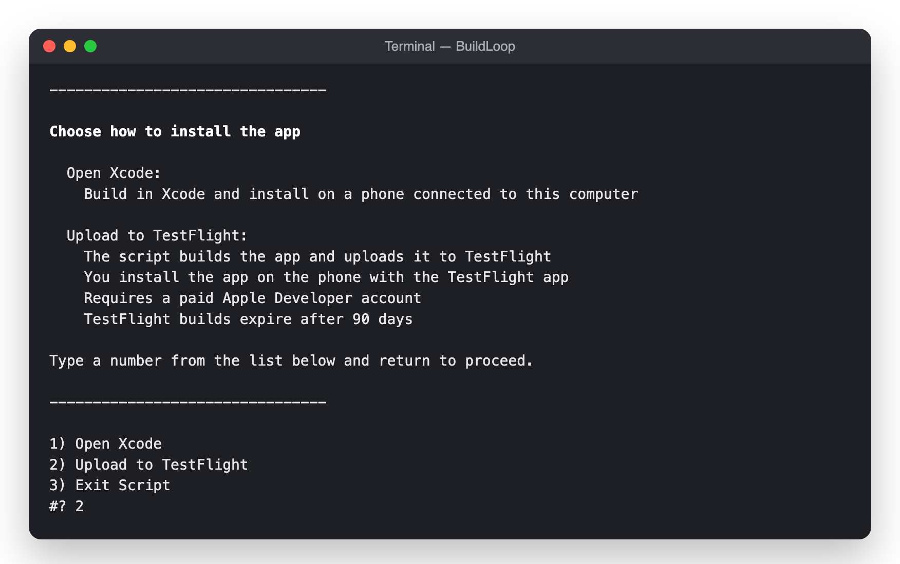{width="700"}
    {align="center"}

2. **Let it build and upload**. The script builds the app, which usually takes 10 to 30 minutes, and then uploads it to Apple. When both steps show a green check mark, you're done at the Mac.

    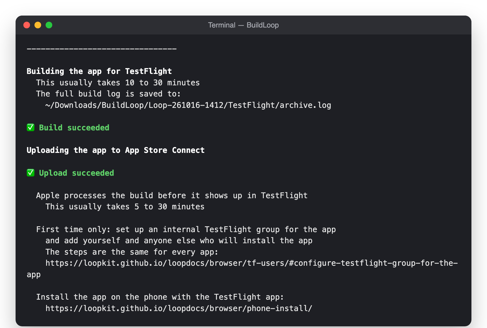{width="700"}
    {align="center"}

3. **First time only:** let Xcode register the app. If Apple doesn't know about this app yet (for example, you've never used Browser Build for it), the script opens Xcode and shows four steps to follow. The app name must be unique across the whole App Store, so use the name the script suggests. You only do this once.

    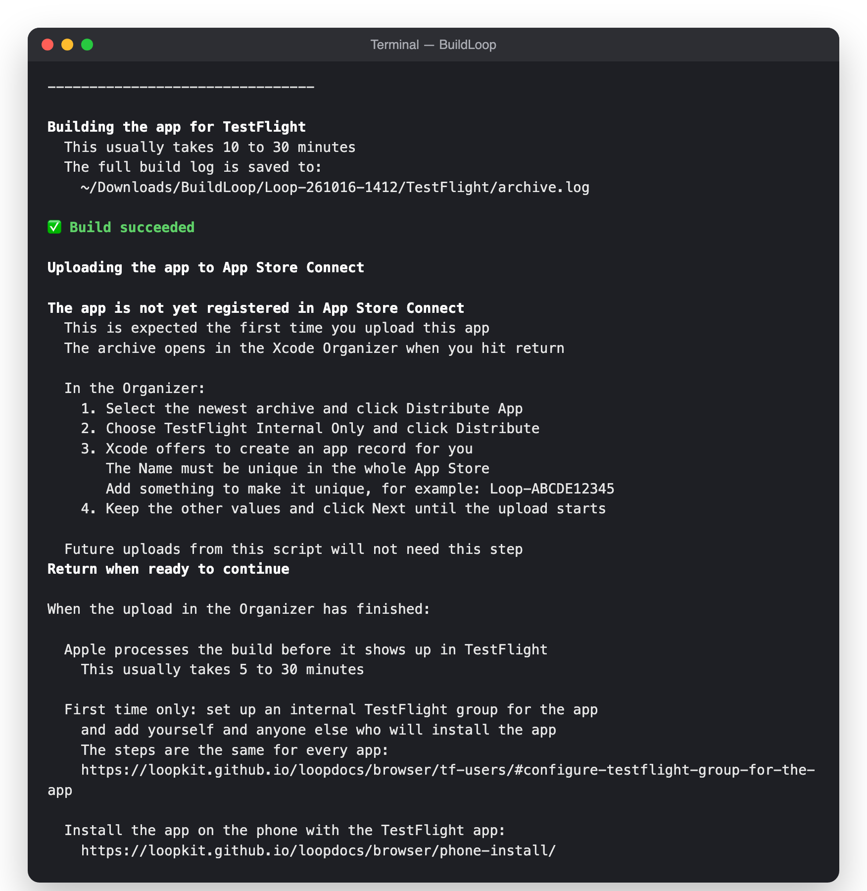{width="700"}
    {align="center"}

4. **Wait for Apple.** Apple processes each new build before it shows up in TestFlight. That usually takes 5 to 30 minutes.
5. **First time only: set up your TestFlight group.** Add yourself and anyone else who will install the app on a phone. If you use Browser Build, you've done this already. [LoopDocs: Configure TestFlight Group](../browser/tf-users.md#configure-testflight-group-for-the-app){: target="_blank" }
6. **Install on the phone.** Open TestFlight on the phone and tap Install or Update. [LoopDocs: Install with TestFlight](../browser/phone-install.md){: target="_blank" }

### Good to know

* **TestFlight builds expire after 90 days.** An expired app won't open, so automation stops. Set a calendar reminder to build again well before then, and keep a backup plan for diabetes care.
* **Xcode is still there.** Option 1 opens Xcode exactly as before.
* **If the upload fails,** the script lists the usual causes and opens Xcode so you can retry and see a clearer error.
* **Need help?** You can [get help from your favorite site for build help](../intro/loopdocs-how-to.md#how-to-ask-for-help){: target="_blank" }

## Manual Method to Upload to TestFlight

Before there was a script, the manual method was developed and instructions provided on this page.  Using the script method is far easier, but we're keeping these instructions for historical reasons.

This guide can also be followed to install other apps you build with *Xcode* via *TestFlight*. Examples include <code>LoopFollow</code>, <code>LoopCaregiver</code> and <code>xDrip4iOS</code>.

Some useful features of using *TestFlight* to install Loop:

* You don't need to plug your phone into your computer
* You can update Loop on your kid's phone while they're away at college
* Reinstalling Loop on the fly is quick and easy from your phone, even if you accidentally delete the app, see [Protect that App](build-app.md#protect-that-app), or need to install Loop on a brand new phone

Since apps built with *TestFlight* expire after 90 days, it is suggested you also setup a build using the [Build with Browser](../browser/bb-overview.md) method even if you don't plan on using it. The GitHub build can be updated in a few minutes from any browser and is an extra layer of protection in these scenarios if you do not have access to your Mac for a rebuild:

* Your Xcode built Loop in *TestFlight* expires
* An urgent update to Loop is released

In all cases, except accidental deletion of Loop or loss of phone, the Loop you install from *TestFlight* builds over your existing app and you keep all your settings including your pump.

- - - 

## Build to *TestFlight* via Xcode

### Initial Steps

Before creating the app or uploading it to *TestFlight*, use the [Build with *Mac*](../build/overview.md) guide to [sign your targets](../build/build-free-loop.md#select-signing-capabilities-tab) and build Loop to a [simulator phone](../build/build-free-loop.md#build-to-a-simulator) in Xcode. This checks to ensure the app you upload to your *TestFlight* will work as expected.

### Archive the Project

Change the build target to from building to a simulated phone to **LoopWorkspace > Any iOS Device (arm64)** like the image below.

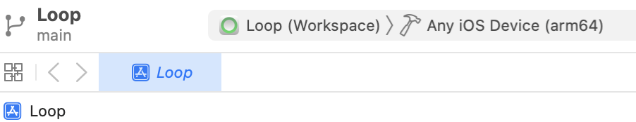{width="700"}
    {align="center"}

Now go to the top menu and choose **Product > Clean Build Folder**. Once it's done, it should say "Clean Finished".

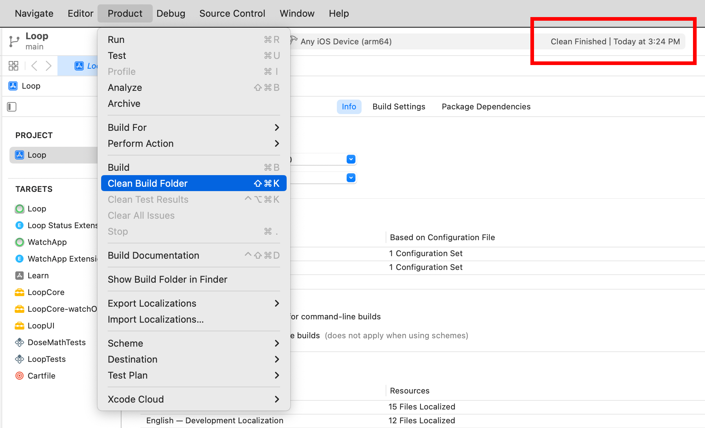{width="700"}
    {align="center"}

Go back to the top menu and choose **Product > Archive**. This will build Loop into a file rather than a phone or simulator. It should take about the same amount of time as building to a phone or simulator does.

- - -

## Upload the Archive

Once the archive finishes building, it should automatically open the **Archives** window. If you want to open this window without re-archiving, click the following in the top menu: **Xcode > Window > Organizer**.

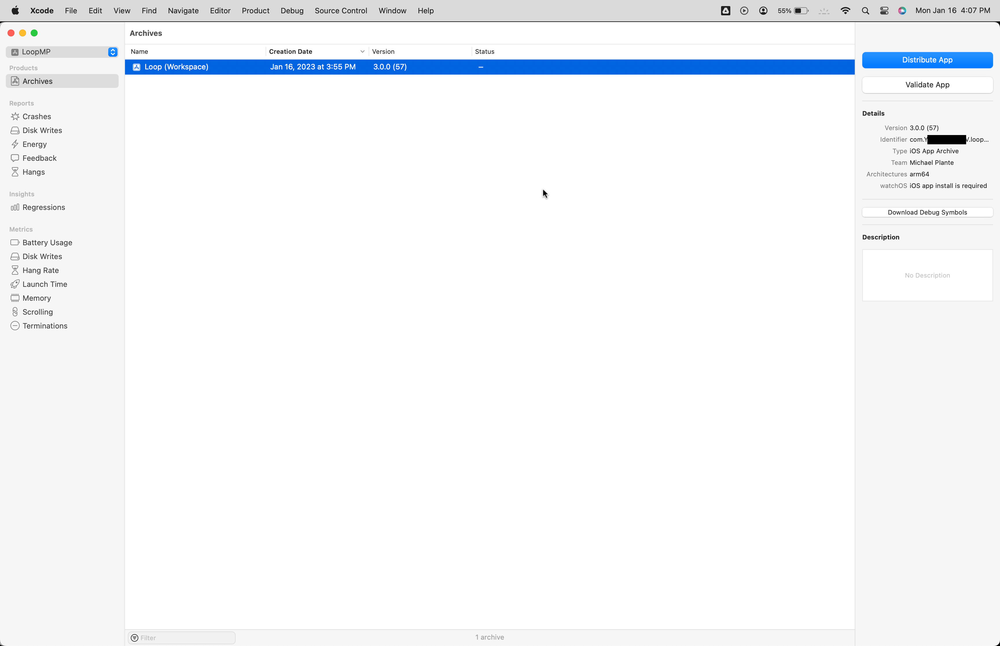{width="700"}
    {align="center"}

Select the archive and click **Distribute App**. If you've archived the project before, be sure to select the archive you intend to upload - most likely the one with the most recent **Creation Date**. 

On the next screen, **App Store Connect** is selected by default. Click **Next**.

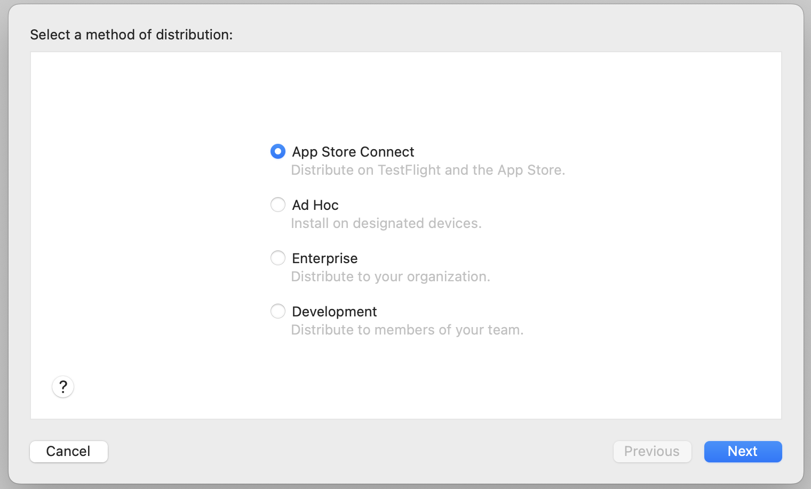{width="700"}
    {align="center"}

On the next screen, **Upload** is selected by default. Click **Next**.

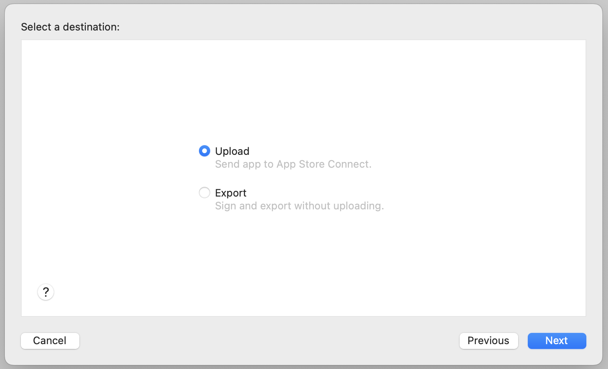{width="700"}
    {align="center"}

### First-Time Archive Upload

If you have already created a *TestFlight* for Loop via Xcode or the GitHub Build method, the next screen will not be shown, so skip ahead to [Subsequent Archive Upload](#subsequent-archive-upload).

If this is the first time you're creating a *TestFlight* for Loop, enter the following on the next screen and click **Next**:

* **Name:** Enter a name that is unique. Most people just use "Loop" followed by their initials, so James Kirk would use "LoopJK". If he gets an error that the name is already taken, he might try something like "LoopJTK" or "Loop_JTK_1701".
* **SKU:** This can be anything, but it can't be the same SKU that you've used for a different app that you've created a *TestFlight* for. Ideally, just leave it as the autofilled bundle id.
* **Primary Language:** Set this to your primary language.
* **Bundle Identifier:** This should already be autofilled. If it's not, it should be "com.YOUR_TEAM_ID.loopkit.Loop". Make sure you replace YOUR_TEAM_ID with your actual TEAM ID, which you can find at [developer.apple.com/account](https://developer.apple.com/account).

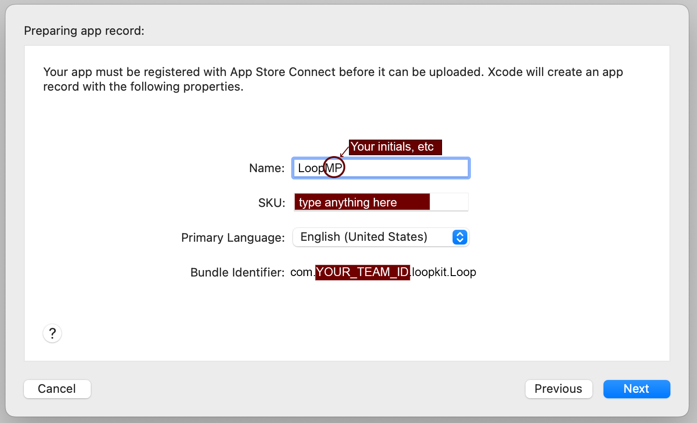{width="700"}
    {align="center"}

### Subsequent Archive Upload

On the next screen, leave everything checked and click **Next**.

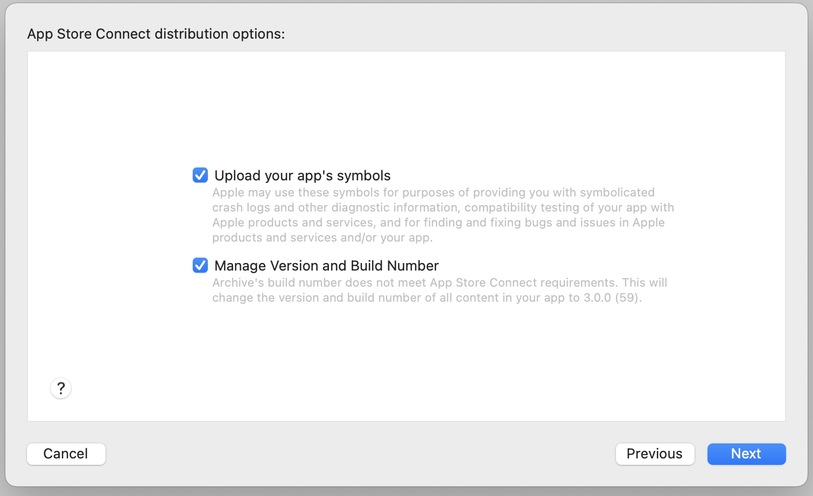{width="700"}
    {align="center"}

On the next screen, leave it set to **Automatically manage signing** and click **Next**. You will see a few messages as it performs some tasks. Be patient.

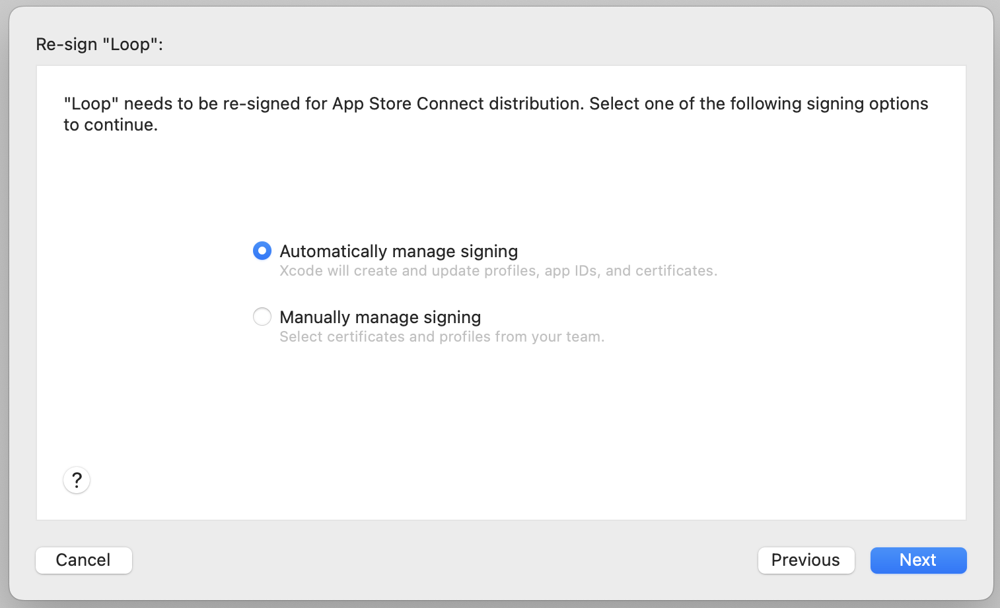{width="700"}
    {align="center"}

When you see the next screen, click **Upload**.

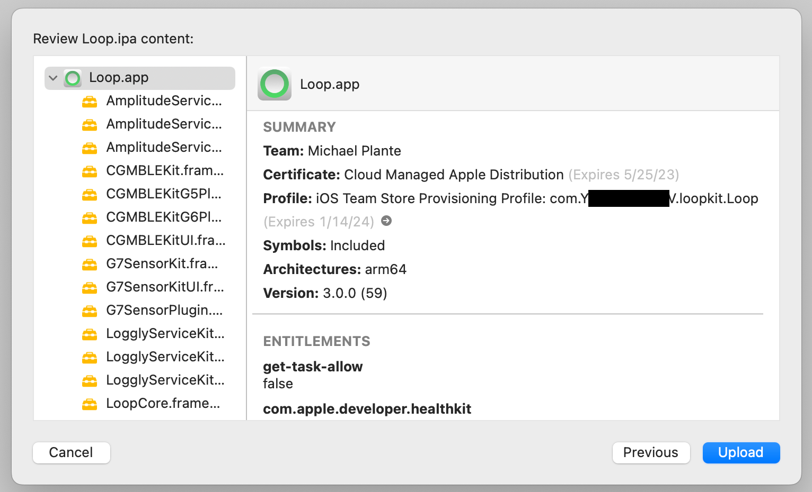{width="700"}
    {align="center"}

Wait until uploading is finished. Don't be alarmed if you see the following screen, just click **Done**.

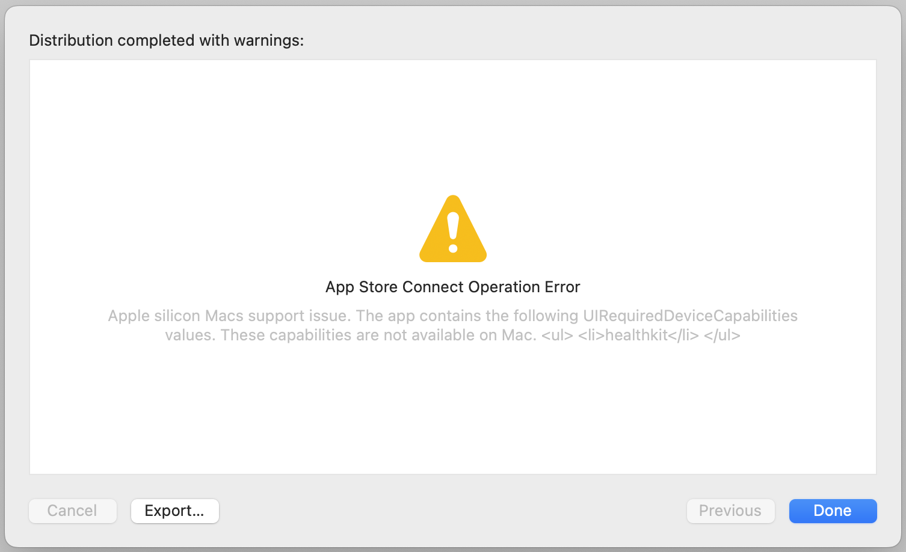{width="700"}
    {align="center"}

- - -

## Deploy App

Now that your app is uploaded to *TestFlight*, it will take some time before it finishes processing and becomes available for installation on your iPhone.

* You can check [appstoreconnect.apple.com/apps](https://appstoreconnect.apple.com/apps) to find its progress by clicking **Test Flight** and then **iOS** under **Builds** in the upper left. 
* Once it no longer says "Processing" and instead says "Ready to Submit" next to the build's number, it should be available and ready to install on your iPhone.
* The processing is normally done within half-hour but sometimes *Apple* gets slowed down; be sure to refresh your browser to see if processing completed since the last time you checked

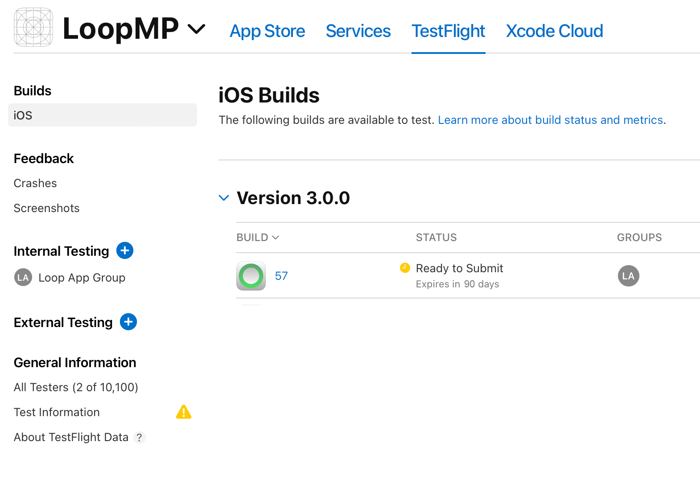{width="700"}
    {align="center"}

### First Time with *TestFlight*

If you are a repeat user of *TestFlight*, skip ahead to [Install App from *TestFlight*](#install-app-from-testflight).

When you use *TestFlight* to distribute the app to yourself or a family member, you create an Internal *TestFlight* Group.

* You will add yourself - your email address will already be available
* If you want to add others, you must add the email addresses for these users. Each email address must match that associated with each Apple account
* This group can be edited as needed to add or remove members

> If one of your users is a child, you or another adult will need to log into the `Media & Purchases` portion of their phone to install and use *TestFlight* and to install each new build of the app from *TestFlight*. Do not try to add a child to your Internal *TestFlight* Group.

This link provides the instruction you need as a first-time *TestFlight* user.

* [Prepare TestFlight Group](../browser/tf-users.md){: target="_blank" }

You must also install the *TestFlight* app on the phone of the person who will be using the app you just built.

* Follow the instructions at [Install *TestFlight*](../browser/phone-install.md#install-testflight){: target="_blank" }

Continue with the next section, which covers the steps needed for each new *TestFlight* build.

### Install App from *TestFlight*

The members of your Internal *TestFlight* group are notified via email each time a new build is available. They can choose to install the new build of the app from *TestFlight*.

* Follow the instructions at [Install App with *TestFlight*](../browser/phone-install.md#install-app-with-testflight){: target="_blank" }

When installing the app for a child, there are additional instructions.

* [*TestFlight* for a Child](../browser/phone-install.md#testflight-for-a-child){: target="_blank" }

- - -

## Update App

Apps installed via *TestFlight* are only valid for a maximum of 90 days, so you must upload a new build to *TestFlight* at least every 90 days.

To update, simply repeat the steps on this page.
