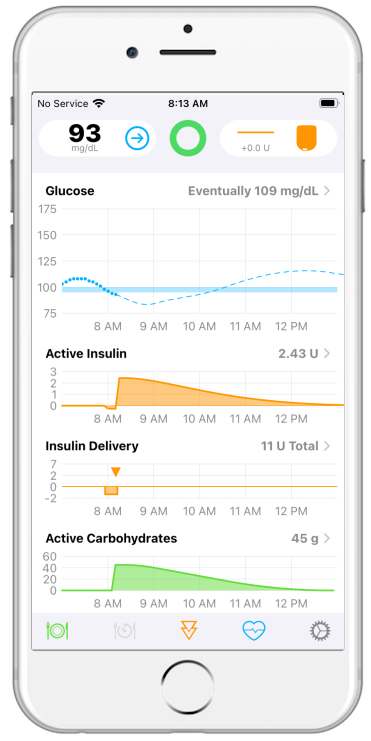
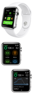

---
hide:
    - navigation
---

*LoopDocs* explains how to build, set up and use the *Loop* app.

## What is the *Loop* App?

The *Loop* app is an automated insulin delivery app that you build and run on an iPhone.

{width="300"}
{width="200"}

* It uses your settings, meal entries and CGM readings to adjust insulin and keep your glucose in the correction range you choose
    * You enter your therapy settings, such as basal rates, carb ratio and insulin sensitivity
    * You choose your CGM and pump
* You choose how the app runs:
    * <code>Closed Loop</code>: the app predicts your glucose and adjusts insulin for you
    * <code>Open Loop</code>: the app only makes recommendations; use it to learn the app, test settings and practice meal entries

### What is&nbsp;_Loop_&nbsp;Video

!!! success "&nbsp;_Loop_&nbsp;Video"
    * The [What is&nbsp;_Loop_](https://youtu.be/64qhgnmkyAE) video and its [slides (pdf)](http://www.loopandlearn.org/wp-content/uploads/2021/05/What-is-Loop.pdf) are from the&nbsp;Loop and Learn&nbsp;team. They show an earlier version of the app, but are still a good introduction.
    * Thanks to Tina and Reese Hammer for the video and Matthew Fouse for the graphics

## What are my next steps?

This site shows you, step by step, how to [**build**](intro/requirements.md){: target="_blank" }, [**set up**](setup/overview.md){: target="_blank" } and [**operate**](operation/loop/open-loop.md){: target="_blank" } the *Loop* app. You do not need a technical background.

You can build the app two ways:

* With a [browser](browser/bb-overview.md){: target="_blank" } on any computer or tablet; the app installs on your iPhone with *TestFlight*
* With an **up-to-date** [*Mac*](build/overview.md){: target="_blank" }; the app installs directly on your iPhone

Read this site before you start, and come back to it often. Expect to test and adjust your settings. If you get stuck, ask the volunteer community, and tell us which page confused you.

> Do It Yourself (DIY) does not mean Do It Alone!

Once you use the app, follow at least one support group for important updates.

## Important Disclaimer

Talk with your health care professional about your diabetes management.

* The *Loop* app is open-source software used by many people. No government agency has approved it for therapy.
* **You take full responsibility for building and running this system and do so at your own risk.**

## Volunteer Community

Volunteers write the code, answer questions and keep this website up to date, in their personal and family time. Please give some of your time too: read this website before you start using the *Loop* app.
