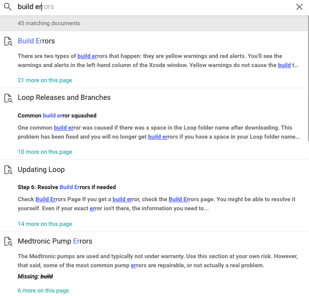

!!! tip "Take a deep breath"
    It is totally understandable if the thought of building and operating your own&nbsp;Loop&nbsp;app feels intimidating.
    
    As you learn the information explained in&nbsp;_LoopDocs_, this will start feeling more comfortable.

## How *LoopDocs* is Organized

The tabs across the top of each page (or the menu on a phone) are in the order you use them: check the requirements in Intro, build the app, set it up, operate it, and troubleshoot. The Version, *Nightscout* and FAQs tabs hold reference information.

## How to Use *LoopDocs*

### Using Links

You will notice many links in the *LoopDocs* pages pointing to detailed information. 

* If you notice an arrow pointing up and to the right beside the link:
    * This means a new tab or window (depending on your browser configuration) is opened when you click on the link
    * For example, the [What is Loop?](https://youtu.be/64qhgnmkyAE) video is found on *YouTube*

* This link format is used anytime the link will take you to a different website
* In some cases, it is also used when referring to a different *LoopDocs* page

### Using Tooltips

The *LoopDocs* pages contain words that may be unfamiliar. For a definition of any word with a dashed underline, simply hover your mouse over the word, or tap on the word on a mobile device, to view the definition. For example, Omnipod has a tooltip.

Every tooltip definition is also found in the [Glossary](../faqs/glossary.md) - so head over there if you have trouble reading a tooltip.

### Website Short Cuts

One of our awesome Loop volunteers captured the domain names  `loopdocs.org` and `looptips.org`.  So you can find these valuable websites by simply typing loopdocs or looptips followed by .org in your browser. In other words, you don't need to remember or type `https://loopkit.github.io/loopdocs/`.

### Website Navigation

There are a lot of links you can click on this website.

* Some links take you to a different section of the same page
* Some links take you to a different page in LoopDocs
* Some links take you to a different website

If you click on the link, you are moved to the new location and must hit the back button on your browser to return.

You can choose to open that link in a new window or new tab.

* If your mouse has a right button, then right click the link
* On a Mac with no right button, hold down the Control key and click
* On a mobile device, click and hold the link and choose where to open the link

!!! tip "Keyboard Navigation"
    When viewing the site at a computer, you can use keys as shortcuts:
    
    * `n` for next page
    * `p` for previous page
    * `s` for search

The website navigation depends on whether you are on a mobile device or a computer (with browser width > 1220 pixels). 

* For the wide-view:
    * The tabs for the different sections of LoopDocs are visible across the top of the browser
    * Once a tab is selected:
        * That tab is highlighted
        * The list of pages in that tab is displayed on the left side
        * The Table of Contents for the current page is displayed on the right side
* For the mobile (or narrow) display:
    * From the Home page, tap the Hamburger Menu to display the tabs for the different sections of LoopDocs
    * Once a tab is selected:
        * The list of pages in that tab is displayed in the Hamburger Menu
        * To return to the main tab list, tap the back arrow
        * To see the Table of Contents, use the Hamburger Menu and scroll to the highlighted page (current page) and tap again

### Website Search

It is not uncommon to have a question about Loop. But, it is exceptionally rare to have the question not already answered in LoopDocs, so please **search for answers** by selecting the Search tool (upper right) or typing `s` then a search term at a computer. As you begin to type, suggested completions and links to pages are displayed. Click on the item you think answers your question.
      {width="600"} 
