## Pump Choices

You can choose a pump from the Heads-Up-Display ([HUD](displays.md#heads-up-display)) or from the [Loop Settings](settings.md) screen.

The HUD looks like the graphic below if no CGM or Pump is chosen:

{width="350"}
{align="center"}

!!! question "Switching Pumps?"
    To change the pump connected to Loop go to [Change Pump Type](#change-pump-type).

Loopers can choose from multiple pumps and a simulator:

=== "Loop 3"

    * [Omnipod](#omnipod-setup) (v3.14.11 or newer, v3.14.2 through .7 displayed "All Omnipod Types")
        * Omnipod Classic (Eros)
        * Omnipod DASH
        * Omnipod 5 (v3.14.7 or newer)
    * [Medtrum Nano patch pump](#medtrum-nano-setup) (available with v3.14.2 and newer)
    * [Minimed](#medtronic-setup)
        * Note: only some Medtronic Minimed pumps are compatible
        * Please refer to [Compatible Pump](../intro/pump.md#check-medtronic-pump-version) for additional details
    * [Dana-i / DanaRS-v3](#dana-i-danars-v3-setup) (**work-in-progress; new pump manager, use with care**)
        * Note: DanaRS-v1 or any Dana Korean versions are not supported
    * Insulin Pump Simulator

=== "Loop 4"

    --8<-- "includes/next-dev-note.md"

    * [Omnipod](#omnipod-setup)
        * Omnipod Classic (Eros)
        * Omnipod DASH
        * Omnipod 5
    * [Medtrum Nano patch pump](#medtrum-nano-setup)
    * [Minimed](#medtronic-setup)
        * Note: only some Medtronic Minimed pumps are compatible
        * Please refer to [Compatible Pump](../intro/pump.md#check-medtronic-pump-version) for additional details
    * [Tandem Mobi](#tandem-mobi-setup) (**open beta; new pump manager, requires the `feat/tandem-next-dev` branch, use with care**)
    * Insulin Pump Simulator
    * Dana is not available for *Loop* 4 at this time

!!! info "Omnipod Terms"
    The Loop app and LoopDocs use these terms. For any supported Pod Type, select `Omnipod` when choosing your pump.

    * **Omnipod 5**
    * **Omnipod DASH**
    * **Omnipod Classic** is the older (Eros) pods (requires [RileyLink](../intro/rileylink.md){: target="_blank" } compatible device to Loop)

- - -

## Add Pump

=== "Loop 3"

    Tap on Add Pump in the Settings screen to see pump options (shown in the graphic below).

    Tap on your Pump.

    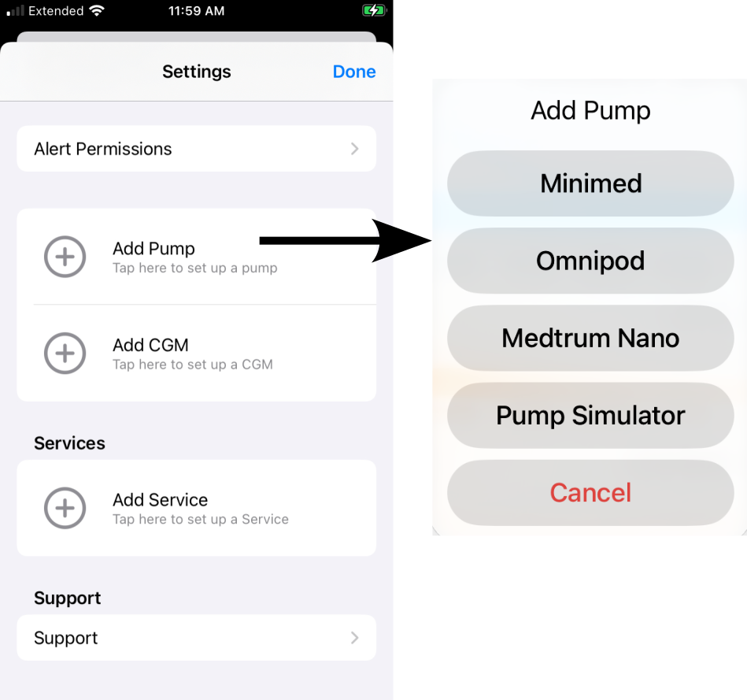{width="500"}
    {align="center"}

    Then continue with the appropriate section for your pump:

    * [Omnipod Setup](#omnipod-setup)
    * [Medtrum Nano Setup](#medtrum-nano-setup)
    * [Medtronic Minimed Setup](#medtronic-setup)
    * [Dana Setup](#dana-i-danars-v3-setup)

    !!! note "Feature Branch Pumps"
        Dana only appears in the list of pumps if you built a feature branch that includes that pump manager.

=== "Loop 4"

    --8<-- "includes/next-dev-note.md"

    Tap on Add Pump in the Settings screen. A full-screen chooser opens with the pumps grouped by manufacturer. Each one shows an icon and a list of the supported models.

    Tap on your Pump.

    !!! abstract "Graphic needed"
        A graphic of the *Loop* 4 pump chooser will be added here.

    Then continue with the appropriate section for your pump:

    * [Omnipod Setup](#omnipod-setup)
    * [Medtrum Nano Setup](#medtrum-nano-setup)
    * [Medtronic Minimed Setup](#medtronic-setup)
    * [Tandem Mobi Setup](#tandem-mobi-setup)

    !!! note "Feature Branch Pumps"
        Tandem Mobi only appears in the list of pumps if you built the `feat/tandem-next-dev` branch.

## Omnipod Setup

You will see the welcome screen for `Omnipod`. When done reading, tap on the blue Continue button.

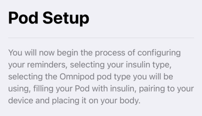{width="250"}
{align="center"}

### Pod Expiration Reminder

In this screen, you choose the default expiration reminder you prefer. After you make your selection, tap on the blue Next button.

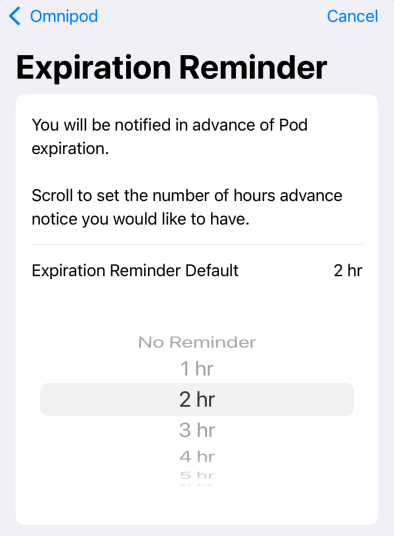{width="250"}
{align="center"}

### Pod Low Reservoir Reminder

In this screen, you choose the default low-reservoir reminder you prefer. After you make your selection, tap on the blue Next button.

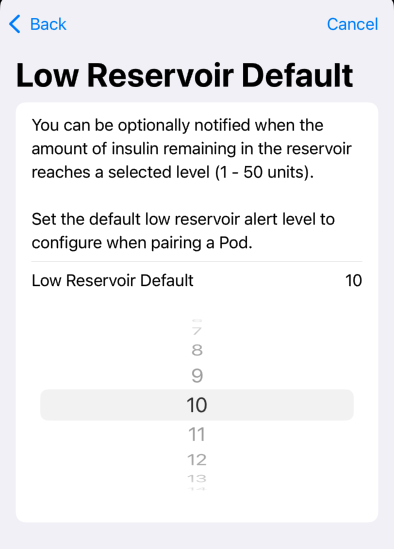{width="250"}
{align="center"}

### Pod Insulin Type

In this screen, you choose the Insulin type you use for your pods. This screen is common for all pumps. After you make your selection, tap on the blue Continue button.

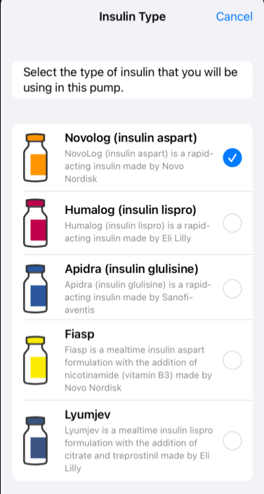{width="250"}
{align="center"}

### Pod Type

In this screen you choose the Pod Type you will be pairing. After you make your selection, tap on the blue Confirm Pod Type button.

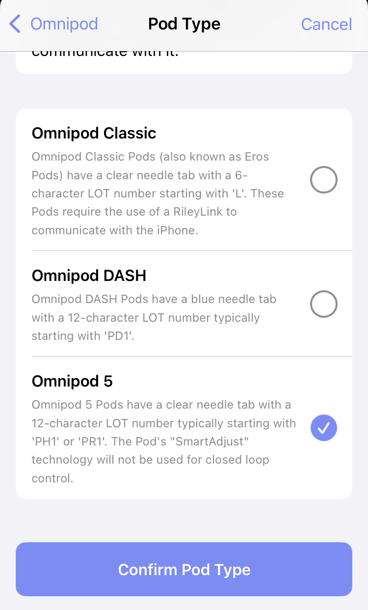{width="250"}
{align="center"}

If you select Classic (Eros) pods, you will be routed to the [Select RileyLink](#select-rileylink) screen before reaching the Pair Pod screen.

If you select Omnipod 5 and you do not have a certificate installed yet, you are automatically routed to a service that provides you with the certificate you need. You will have to tell the app to continue, then several progress screens will flash past until you see this final screen. You must have **Internet access** for this one-time set. Once you have a certificate, it is good for this phone and this app.

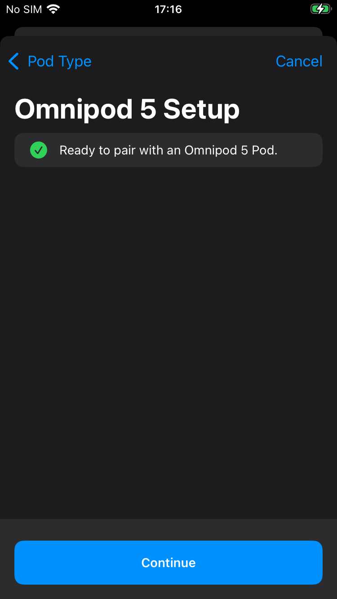{width="300"}
{align="center"}

At this point, you can tap Continue and will be taken to the Pair Pod screen. It is now safe to fill your Omnipod 5 Pod with insulin and pair it.

Because of the extra exchanges required to handle the security amd setup for Omnipod 5 Pods, the pairing process may seem longer than for a DASH Pod. This is normal.

### Pair Pod

At this point - you can pair your pod or hit `Cancel` (upper right of screen). You have completed the onboarding of the pump manager that handles all supported types of Omnipod Pods. The Pair NAME Pod screen is slightly different for each Pod Type. Make sure you have chosen the correct Pod Type to match your Pods.

!!! tip "New Looper / New Podder"
    Carefully review the [Pair Pod](../pumps/omnipod.md#pair-pod){: target="_blank"} instructions before continuing. Then, when you are ready, pair a pod.

    If you are not ready to fill and attach a pod with insulin, try filling a pod with water and let it drip into a ziplock bag to test running Loop on the pod. (Be sure the pod is not near anything when you hit "Insert Cannula".)

    You may enjoy reading [Rufus the Bear](https://www.loopandlearn.org/sl-rufus/).

## Medtrum Nano Setup

### Medtrum is a New Pump Manager

**Medtrum is available in released code with v3.14.2 or newer.**

!!! important "Do not use the EasyPatch App when running an OS-AID"
    The **Medtrum** pump can be controlled by the vendor's EasyPatch App or by the OS-AID app but not by both.

    If you have EasyPatch on your phone - make sure you have forgotten the pump base serial number in the EasyPatch app before attempting to connect a Medtrum Patch to your OS-AID app using that same pump base.

### Confirm Patch and Pump Base are Compatible

!!! info "All versions are supported!"
    Both 200U (MD0201 & MD8201) and 300U (MD8301) version are supported with the correct version of the *Loop* app.

!!! warning "Always check your REF's"
    Before connecting your pump base with your patch, always check the REF on your patch with the REF on your pump base.
    The first 3 digits should always match, the patch always ends with 0, while the pump base always ends with 1.
    Do not use the patch if they do not match.

    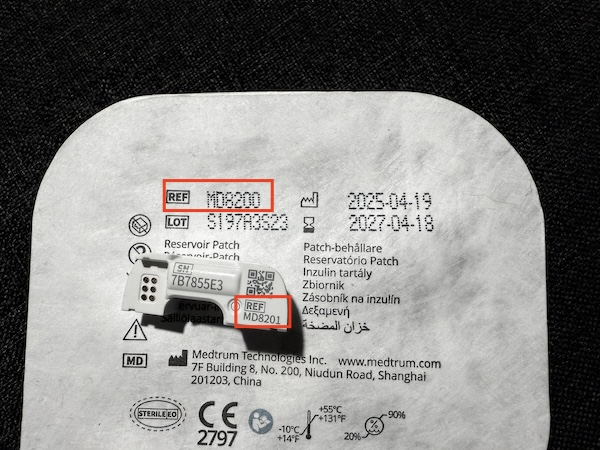{width="450"}
    {align="center"}

### Add Medtrum Nano Pump

!!! important ""
    If you previously used the Medtrum EasyPatch app, be sure to disconnect the pump base from the EasyPatch app before adding it as your new pump

You can only add the Medtrum patch pump when no pump is selected.

If you already have a pump selected, you must first delete the pump as detailed in [Change Pump Type](#change-pump-type).

1. Select [Insulin Type](#insulin-type)
1. Check [Patch settings](#patch-settings)
1. Enter your [pump base Serial Number](#check-pump-base-serial-number)
1. Prime & Activate patch. See [Activation flow patch](#activation-flow)
    1. Note, make sure the pump base is connected to your patch before adding insulin

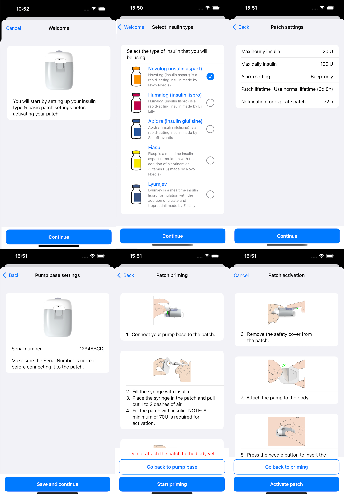{align="center"}

### Patch settings

!!! info "Good to know"
    All of these settings can be adjusted throughout the lifespan of the patch. You can safely update them after activating the patch

There are several settings you can setup while using Medtrum nano with the *Loop* app:

1. `Max hourly insulin` & `Max daily insulin`: Medtrum Nano does not work with max bolus and max basal settings, it uses max hourly & max daily insulin. Just like the names suggests, it controls the maximum amount of insulin per hour or per day. 
1. `Alarm setting`: The Medtrum Nano has the ability to make a beep it there is an occlusion, patch fault, empty battery, etc. These alarms can also be silenced using this setting
1. `Patch lifetime`: Normally, the medtrum nano runs for 3 days and 8 hours. This ensures the funcioning of the patch. You can disable this limit with this setting to extend the lifetime of the patch untill an failure occures, like an occlusion, empty battery, etc
1. `Notification for expiration patch`: If the `Patch lifetime` setting is set to normal lifetime, you have the ability to update this setting. With this setting, you can control at what point you get a reminder notification for replacing the patch

### Check pump base serial number

After checking the patch settings, you are prompted to enter the pump base serial number.
This serial number is used by the *Loop* app to connect to the correct pump base.
To see your serial number, grab your pump base and look at the bottom of the base.
It should have a QR code and a small 8 character serial number.
See image below:

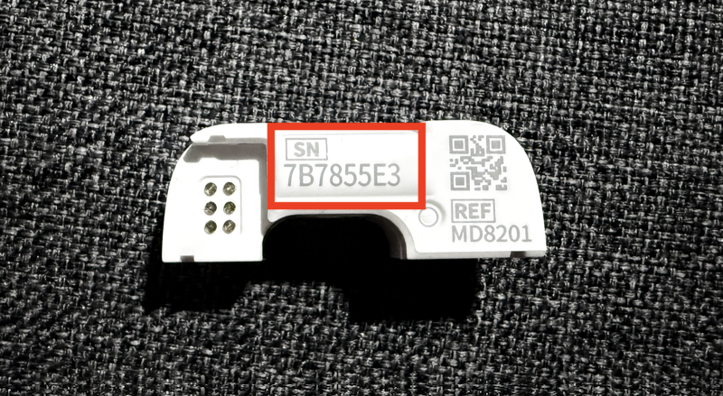{width="450"}
{align="center"}

### Activation flow

!!! warning "IMPORTANT"
    While the priming is running, DO NOT USE THE CANCEL BUTTON.
    This might corrupt the activation flow, so please be patience while the priming process is running.

!!! warning "IMPORTANT"
    Connect your pump base to the patch before adding insulin to your patch.
    Otherwise, you might corrupt the activation flow.

After the serial number prompt, you need to setup the patch itself.
Follow the visual guide in the *Loop* app and press "Start priming" to start priming the cannula of the patch.
It is important to not attach the patch on your body before the priming process completes.

After priming, follow the rest of the visual guide in the *Loop* app.
From here, you can attach the patch to your body and complete the activation process.

- - -

## Medtronic Setup

After you choose Medtronic as your pump, you must go through these steps:

1. Select [Insulin Type](#insulin-type)
1. Select [RileyLink](#select-rileylink)
1. [Prepare Medtronic Pump](#prepare-medtronic-pump)
1. [Connect Pump to Loop](#connect-pump-to-loop)

### Insulin Type

You can choose from the insulin types below. This screen is common for all pumps. After you make your selection, tap on the blue Continue button.

* Insulin Type
    * **Rapid Acting** (Novolog, Humalog, Apidra) or **Ultra Rapid** (Fiasp, Lyumjev)
    * Inhaled insulin (Afrezza) is not offered because it is not used in pumps. [Non-Pump Insulin](displays.md#event-history-reservoir-and-non-pump-insulin)

{width="250"}
{align="center"}

### Select RileyLink

For Omnipod Classic (Eros) and Medtronic pumps, you need a RileyLink compatible device to use the *Loop* app.  The Device and your phone must be kept close to your pump to work.

!!! warning ""
    A new RileyLink compatible device is not listed next to its slider until after you connect the device to Loop. Find the little toggle in the device list, switch on that toggle, and the RileyLink will appear after the toggle is green.

    You can [personalize](../pumps/rileylink.md#personalize-device) the name once it is connected to Loop.

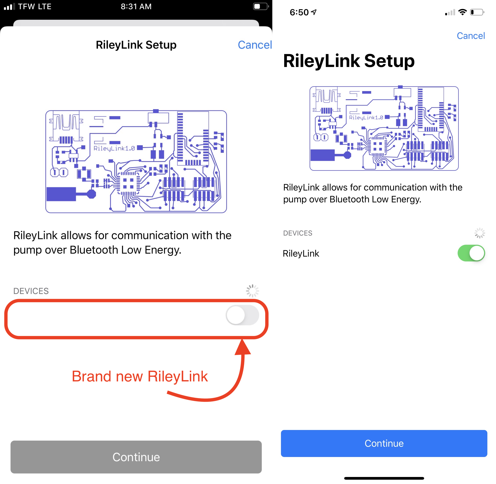{width="400"}
{align="center"}

All RileyLink compatible devices in the nearby area, not already connected to a Loop app, will display in the RileyLink Setup screen. Select your RileyLink by sliding the toggle to display green and then press the blue `Continue` button at the bottom of the screen.

If your device does not appear:

* Make sure it is charged and turned on
* Make sure it is not connected to a different phone or app

If you are adding a Medtronic pump, skip ahead to [Prepare Medtronic Pump](#prepare-medtronic-pump).

### Prepare Medtronic Pump

!!! Tip "No Need to Set the Time"
    If you just added a battery to a Medtronic pump you have not used for a while, the pump initiation screens require you to set the date and time for the pump. You can just accept the default values; when you connect the pump to the *Loop* app, the time and date are automatically set.

!!! warning ""

    **Loop requires these settings on your Medtronic pump.**

    Check with your users guide (can be found online if you don't have one) for more detailed instructions on your model of pump if you're not sure how to accomplish these steps.

    If you have basal rates, insulin to sensitivity factor and carb ratios in your pump - these will be overwritten (using the Therapy Setting values) when you connect your pump to Loop. If those rates are important to you, record them prior to continuing.

- Turn off Patterns under the basal menu settings.
- Set the Max Basal and Max Bolus values in the Medtronic pump to be greater than or equal to the values you enter in the Loop [Therapy Settings](therapy-settings.md#delivery-limits). Otherwise, Loop will not connect to your pump with the error message: `Pump Error. Max setting exceeded`.
- Set your pump's `Temp Basal Type` to `Insulin Rate (U/hr)`.
- Set Remote Devices to `ON` and enter any random ID (010101 will work - avoid using all zeros). This setting is found in the pump's Utilities menu (for x23 continue to Connect Devices, Remotes) and turn `ON` the Remote Options.
- Cancel any currently running extended or dual wave boluses.  Loop cannot loop with those running.

### Connect Pump to Loop

The final step is to connect your Medtronic pump to Loop.

- Make sure your RileyLink is turned on and nearby
- Add your pump's region, color as shown in the graphic below
    * Note that some Canadian pumps use `CM` instead of `CA` for the region code.  Select `CA/CM` in the dropdown menu.

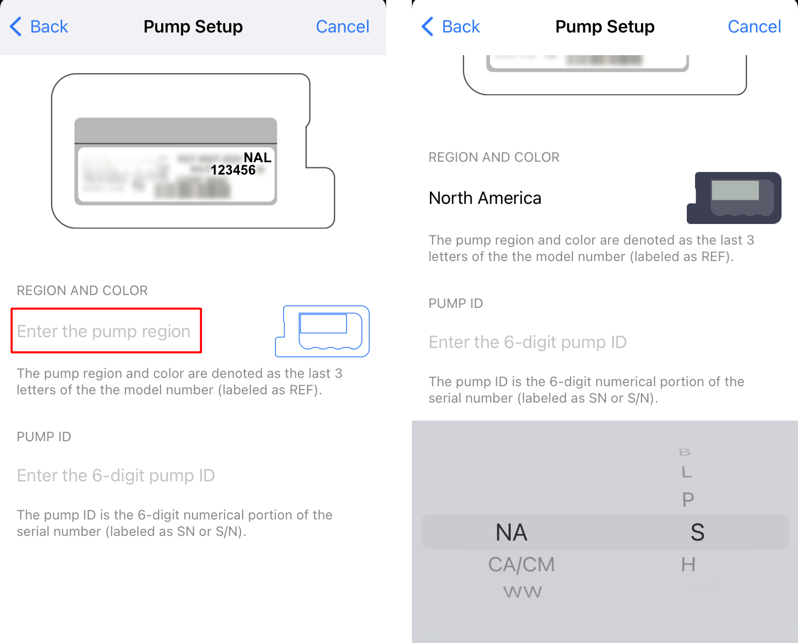{width="500"}
{align="center"}

- Add your pump's 6-digit serial number as shown in the graphic below
- Click the `Connect` button to connect the pump to Loop.
- The spinning icon continues until you see the blue check mark and `Continue` button
    - If Loop is not successful at connecting, you will get an error message and stay on this screen
    - If the [Delivery Limits](therapy-settings.md#delivery-limits) (max basal and max bolus) in the pump are lower than values you entered in Loop you will see an error message: `Pump Error. Max setting exceeded`. (See note below for other reasons you might see this message.)
        - In this case, edit the values in the pump and then click `Connect` to retry.

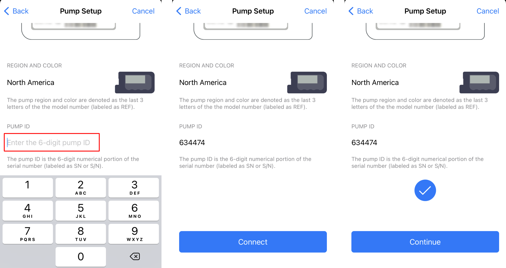{width="750"}
{align="center"}

!!! warning "Max setting exceeded"
    It turns out the "Max setting exceeded" error might be displayed even when Max Bolus and Max Basal Rate are already set appropriately on the pump.

    * If you had previously used a pump that allows multiples of 0.025 U/hr basal rate and you have one of those rates in the basal rate schedule in Loop, you will not be able to connect to a different Medtronic pump that does not support those rates.
    * If this happens to you, cancel out of connecting to that pump
        - Refer to [Prep for Medtronic](settings.md#option-2-prep-for-medtronic) on the Settings page
            - Add a simulator so you can Change the scheduled basal rates
            - Delete the simulator
        - Try again

#### Bolus in Progress

If you get an error `Bolus in progress` on the pump when trying to connect, you probably need to rewind and load insulin into the reservoir.

If the pump has alerted that it is out of insulin, you cannot pair to Loop as a new pump.

#### Final steps

Once you have successfully connected to the Medtronic pump, click on `Continue`:

- You will then be presented with two more screens, click `Continue` for each
    - Pump Clock message
    - Pump is ready for use screen
- If you have an x23 or x54 pump, there is one more step - highlighted below

!!! info "For x23 and x54 Medtronic pump users only"
    | 

 ||
    |---|---|
    |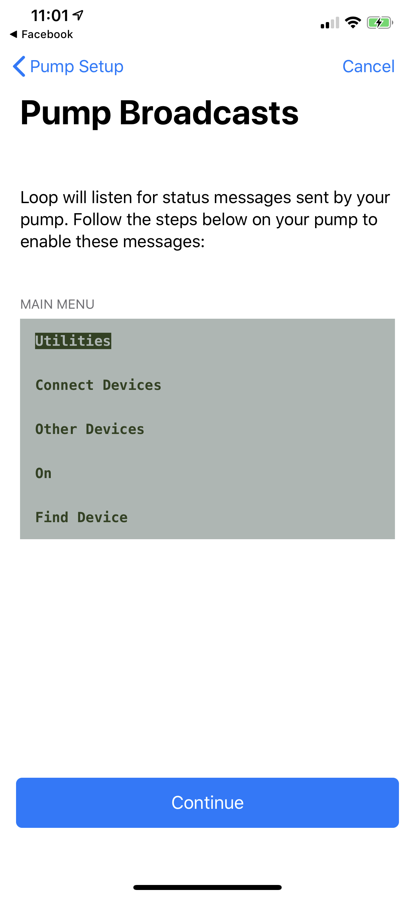{width="550"}|For x23 and x54 Medtronic pump users, there is a packet of information special to those pumps called MySentry messages. If you have never setup this part of the pump previously, you may see a screen, called "Pump Broadcasts", at this point in the setup process.  Follow the directions on the screen. They will require you to take some manual steps on your pump to "pair" it with your Loop app.  Basically, you will need to go to your pump's main menu, scroll down to Utilities, then Connect Devices, then Other Devices, turn that setting On, and then select Find Device. Once you do that, click on the `Continue` button in Loop app and the pairing will take place. This will allow those MySentry packets of information to flow to Loop app.  This step does not apply for x22 or x15 pump users, since those pumps do not have MySentry capabilities.|

Now that your pump is paired with Loop, you should select the type of battery you are using and decide whether to use My Sentry:

1. Select your pump's battery type (lithium or alakine)
    * There is a whole page about [Medtronic pump batteries](../operation/features/battery.md)
2. Leave the Preferred Data Source on Event History
1. If you have an x23 or x54 pump, choose whether to use My Sentry (saves phone battery) or not (saves OrangeLink battery)
    - For other Medtronic pumps, adjusting this setting does not do anything
    - Note that the Orange Link battery drain is substantial
        * Some users reported batteries needed to be changed every 2-4 days compared to 10 days with MySentry off

The Medtronic status and commands available are shown in the [Pump Settings](../pumps/medtronic.md) page.

## Dana-i / DanaRS-v3 Setup

!!! note "*Loop* 4"
    Dana is not available in the `next-dev` branch (*Loop* 4) at this time. This section applies to *Loop* 3 feature branches only.

### Check Dana Pump Version

!!! info "Support for Dana-i"
    All versions of the Dana-i are supported at the moment!

!!! warning "Check your DanaRS version before starting"
    Only the DanaRS firmware v3.0 or higher is supported, every other version is not supported or is untested (The korean versions are untested for example).
    To check your DanaRS version, please go to "Analyze" -> "Model information". The version should be at least `xxx-3.0.0`.

    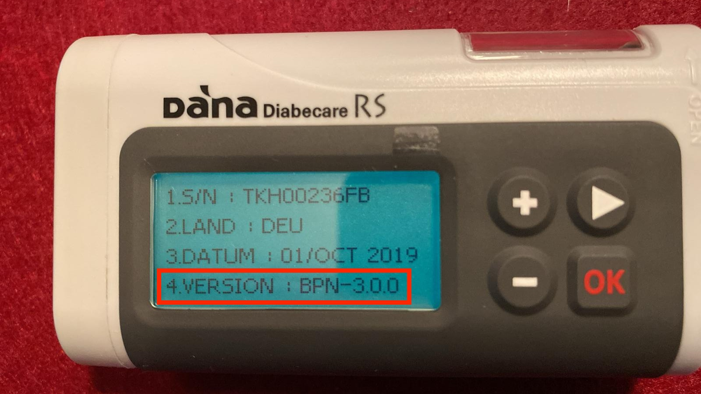{width="450"}
    {align="center"}

### Dana is a New Pump Manager

**WARNING: Dana support in Loop is a work-in-progress.**

### Before Testing Dana

You must build a feature branch to get Dana support in Loop

* `feat/all-managers`.

* Please refer to information summarized at [Status for Dana Support](../version/development.md#status-for-dana-support){: target="_blank" }.

### When Testing Dana

* Please do not use Dana with Loop unless you are willing to test and communicate with [developers on zulipchat in this DanaKit channel](https://loop.zulipchat.com/#narrow/channel/144182-development/topic/DanaKit.20Troubleshooting/with/547829260)

### Add Dana Pump

You can only add the Dana when no pump is selected. If you already have a pump selected, you must first delete the pump as detailed in [Change Pump Type](#change-pump-type).

1. Select [Dana-i / DanaRS-v3](#select-dana-idanars-v3)
1. Select [Insulin Type](#insulin-type)
1. Select [Delivery speed](#delivery-speed)
1. [Pair Dana](#pair-dana)
    * [Dana-i pump](#pairing-dana-i)
    * [DanaRS-v3 pump](#pairing-danars-v3)
1. (Optional): Enable [silent pump tones](#optional-enable-silent-pump-tones)
1. (Optional): [Check if you need a heartbeat](#optional-check-if-you-need-a-heartbeat)

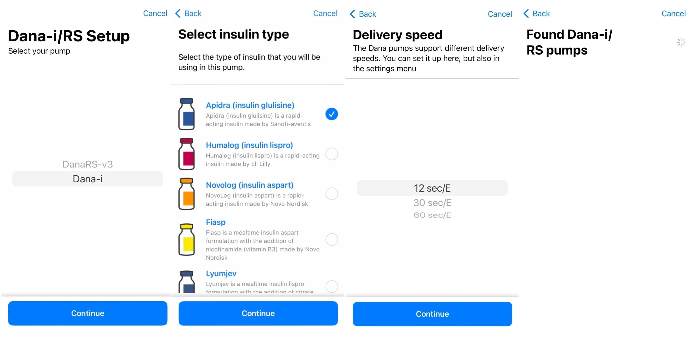{align="center"}

#### Device Name

You will need to have a battery in the pump and you will need the 10-character Device Name for your pump.

Start by checking the device name at the back of your Dana (or inside the "Model information" menu).
Observe the a 10 character device-name listed behind the SN.
The example below is from a Dana-i, but is the same for every Dana pump

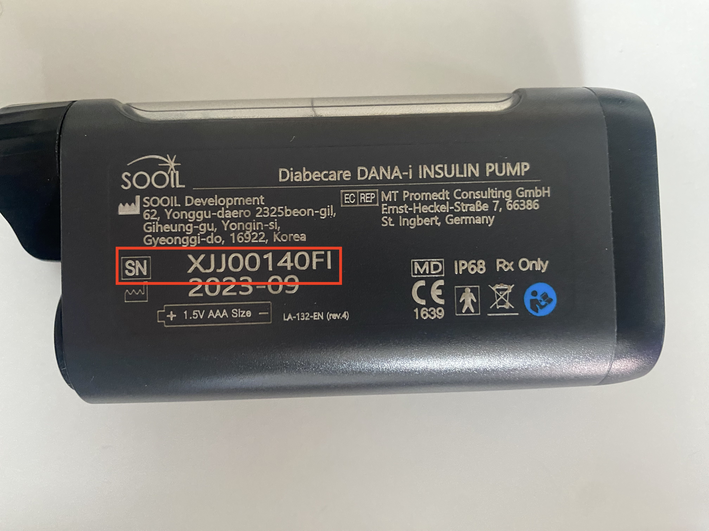{width="450"}
{align="center"}

### Select Dana-i/DanaRS-v3

When you select the "Dana-i/RS" option in the Add Pump screen, you will be prompted to select your pump model.

Choose the pump you plan to use: either Dana-i or DanaRS-v3. You will see a third option, but it is not supported at this time.

After this selection, you will get a short description on how the pairing process will work.

Once you enter the pump type, you will see an information screen for that pump. Read the information and then continue to select the [Insulin Type](#insulin-type).

After choosing insulin type, you will see the [Delivery speed](#delivery-speed) screen.

### Delivery speed

!!! info "IMPORTANT"
    The delivery speed can always be changed in the pump's settings, but you can only have one delivery speed active

The Dana pumps supports several bolus/delivery speeds.
This might be interesting to customize if you want to slow down the bolus speed for insulin types that feel like it is burning.

Dana supports 3 speeds:

* 12 seconds per unit (default)
* 30 seconds per unit
* 60 seconds per unit

### Pair Dana

After you choose Delivery Speed, you will land on the Dana scanning page.

This page will show all the Dana pumps it could find in your area.
Once you see your [device name](#device-name) in the list, click on it and Loop will try to connect to pair with:

* [Dana-i](#pairing-dana-i)
* [DanaRS-v3](#pairing-danars-v3)

#### Pairing Dana-i

Once connected, your Dana-i will prompt you with a question if you want to connect.
Accept this and you will see a code on your Dana-i.
Meanwhile, you will see the standard iOS Bluetooth pairing modal.
Also accept this and fill in the code from your pump into iOS.
After that is done, Loop is ready to use your Dana-i!

#### Pairing DanaRS-v3

Once you see your device name in the list, click on it and Loop will try to connect to your DanaRS-v3.

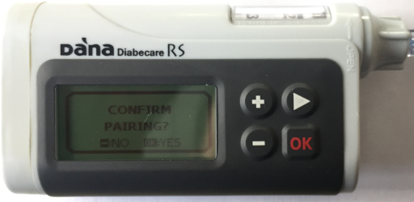{width="450"}
{align="center"}

Once connected, your DanaRS-v3 will prompt you with a question if you want to connect.
Accept this and you will see two codes on your DanaRS-v3.
Meanwhile, you will see a prompt for 2 codes in Loop.
Fill in the codes from your pump into iOS and Loop is ready to use your DanaRS-v3!

### Setup Complete

After the Dana pump is paired to the phone app, you will see the Setup Complete screen. Tap finish to begin using your Dana pump.

### (Optional) Enable silent pump tones

Normally, a Dana pump will make a sound or a vibration every time a bolus is completed.
When Loop is configured with [Automatic bolus](settings.md#dosing-strategy), it might be anoying to have a beep or a vibration for every micro bolus.
Therefore, we strongly recommend user to enable the silent tones.

Sadly, only the Dana distributors know how to enable this feature at the moment.
But we do know you need to set your alarm to sound.
You can do this via: "Settings" -> "User options" -> "4. Alarm"

### (Optional) Check if you need a heartbeat

Most CGM provide a live Bluetooth connection, which the *Loop* app uses as a heartbeat to wake the app with each CGM reading.
Without a heartbeat, the *Loop* app will not run the algorithm when the app is in the background or the phone is locked.

Some pumps can also provide a heartbeat if the CGM you choose cannot provide one.

DanaKit doesn't provide a heartbeat by default.

Therefore, it is important to check if your CGM provides a heartbeat. If it does not, there are battery-intensive work-around methods for Dana pump. See [Dana Heartbeat Modes](../troubleshooting/dana-faq.md#heartbeat-modes){: target="_blank" }.

## Tandem Mobi Setup

### Tandem Mobi is a New Pump Manager

**WARNING: Tandem Mobi support in Loop is in open beta and is a work-in-progress.**

The Tandem Mobi pump manager is called TandemKit. It is not affiliated with or supported by Tandem Diabetes Care.

### Before Testing Tandem Mobi

You must build a feature branch to get Tandem Mobi support in Loop:

* `feat/tandem-next-dev`
* Please refer to [How to Build Feature Branches](../version/development.md#how-to-build-feature-branches){: target="_blank" }

!!! warning "This Branch is Based on `next-dev`"
    The `feat/tandem-next-dev` branch is built on `next-dev`, which is development code for *Loop* 4. It includes changes beyond Tandem support.

    * Read [Status for `next-dev` Branch](../version/development.md#status-for-next-dev-branch){: target="_blank" } before you build
    * You can return to released code (v3.14.12 or newer) after using `next-dev` without deleting the app
    * However, TandemKit is only in the `feat/tandem-next-dev` branch: if you build any other branch, *Loop* cannot control your Mobi pump

### When Testing Tandem Mobi

* Please do not use Tandem Mobi with Loop unless you are willing to test and communicate with developers on zulipchat in the [Tandem Mobi Open Beta topic](https://loop.zulipchat.com/#narrow/channel/144182-development/topic/Tandem.20Mobi.20Open.20Beta/with/640908737)

### Before Adding Tandem Mobi

!!! important "The Mobi Can Only Be Paired With One App"
    The Tandem Mobi can be controlled by the Tandem Mobi app or by the *Loop* app, but not by both.

    * Unpair the pump from any other app before you begin
    * If the pump is listed in your phone's Bluetooth settings (iOS Settings, Bluetooth), tap on the pump name and choose `Forget This Device`

Have these items ready:

* Your Tandem Mobi and its charging pad
* The 6-digit pairing code (PIN)
    * The PIN is located on the inside of the cartridge area of the pump, labeled `PIN`

### Add Tandem Mobi Pump

You can only add the Tandem Mobi when no pump is selected. If you already have a pump selected, you must first delete the pump as detailed in [Change Pump Type](#change-pump-type).

1. Read the welcome screen: `Ready to connect your Tandem Mobi?`
1. Select [Insulin Type](#insulin-type)
1. Choose [Sound Settings](#mobi-sound-settings)
1. [Pair Tandem Mobi](#pair-tandem-mobi)
1. [Load Pump History](#load-pump-history)
1. [Finish Setup](#mobi-setup-complete)

### Mobi Sound Settings

Choose whether the pump beeps or vibrates for each category:

* General (Temp Basal and Bolus)
* Quick Bolus
* Reminders
* Alarms
* Alerts

!!! info "No Silent Option for Temp Basal and Bolus"
    The current Tandem Mobi firmware does not allow silent operation for commands sent over Bluetooth, which is how an OS-AID app controls the pump.

    The pump beeps or vibrates each time the *Loop* app sends it a bolus or temp basal command. This happens whether the command came from an automatic dosing decision or from a bolus you entered yourself on the phone.

    * With [Automatic Bolus](settings.md#dosing-strategy), expect a beep or vibration for every automatic bolus
    * With [Temp Basal Only](settings.md#dosing-strategy), expect a beep or vibration for every temp basal change

### Pair Tandem Mobi

1. Place your Mobi on the center of the charging pad
1. Pick up your pump, wait a second, then double-press the T button
    * You should hear two beeps
1. When the *Loop* app finds your pump, it displays the pump name, for example `Tandem Mobi 123`
1. Enter the 6-digit PIN from the cartridge area of your pump
1. Wait while the *Loop* app authenticates with the pump; this can take up to 60 seconds

If your pump is not detected, tap on `Pump not detected?` for tips. Make sure you have:

* Unpaired the pump from any other apps
* Removed the pump from your phone's saved Bluetooth device list
* Placed the pump on the center of the charging pad
    * If the charging pad and pump don't light up, try a different USB cord or charger
    * Don't use a USB-C to USB-C cable or a high-wattage charger
* If the pump is off or out of battery, hold down the T button for 30 seconds while it is on the charging pad to wake it up

### Load Pump History

After pairing, the *Loop* app shows the insulin delivery information reported by the pump:

* Insulin on Board
* Last bolus delivery
* Current basal rate (or that delivery is suspended)

You are asked if you want to load this information into the *Loop* app so it is included in your IOB.

Which one to choose depends on what you used before adding the Mobi to the *Loop* app:

* **You were using this Mobi before adding it to the *Loop* app:** tap `Load Pump History into Loop`
    * Recent bolus and basal records from the pump are imported, so insulin the Mobi delivered before pairing is included in your IOB
* **You were running the *Loop* app with a different pump before adding the Mobi:** tap `Do Not Load`
    * The *Loop* app already has your recent insulin delivery from the other pump, so do not import history from the Mobi

### Mobi Setup Complete

Keep the pump near your phone while the *Loop* app finishes setup. During this step the *Loop* app:

* Checks the pump's settings
    * If Control-IQ is on, you are told that continuing turns Control-IQ off so the *Loop* app can control insulin delivery
* Saves your settings to the pump
    * Your basal rates, delivery limits and time are written to the pump
    * If this fails, you see a `Pump Settings Not Saved` message; tap `Try Again` with the pump close to the phone
    * The *Loop* app will not set temporary basal rates until your basal rates are saved to the pump
* Reads the pump's current status

When you see `Your Tandem pump is connected!`, tap `Finish`.

## Change Pump Type

Before changing from one pump type to another pump type, you must delete the old pump type.

After you delete a pump, the [Heads-Up-Display](#pump-choices) at the top of the Loop main screen shows the add pump icon. When you tap on that, you are taken to the [Add Pump](#add-pump) screen

* If you are using Medtronic Minimed, Dana (RS/-i) or Tandem Mobi, scroll to the bottom of the pump screen and select `Delete Pump`

* If you are using Pump Simulator on the phone, you must tap on Simulator Settings and then scroll to the bottom of the pump screen and select `Delete Pump`

* If you are using Medtrum or Omnipod, you can only change pump or Pod type when you are between Medtrum Patches or Omnipod Pods

### Change Pod Type

* With Omnipod, you can switch between Pod types or choose a different pump (v3.14.2 or newer) but only after deactivating your current Pod
    * This is not needed when you are changing a pod, so long as the pods are of the same type
    * Tap on *Switch to another pod or pump type* when between pods
    * If you select *Switch pod type*, you are taken to the [Switch Pod Type](../pumps/omnipod.md#switch-pod-type) Selection screen
        * All of your configuration settings are maintained when switching Pod Types
    * If you select Switch pump type, you can add a pump and go through the [Add Pump](#add-pump) screen

    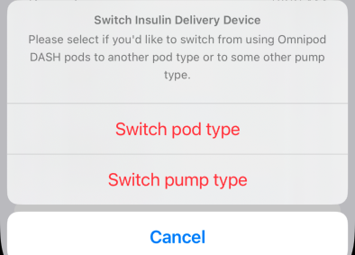{width="350"}
    {align="center"}

